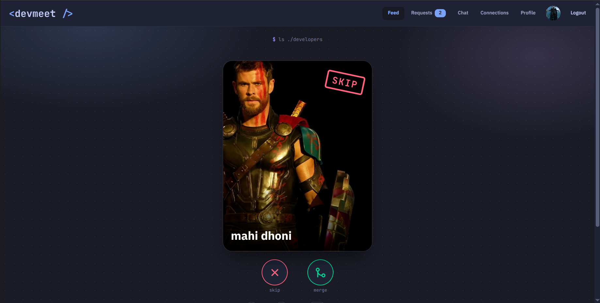
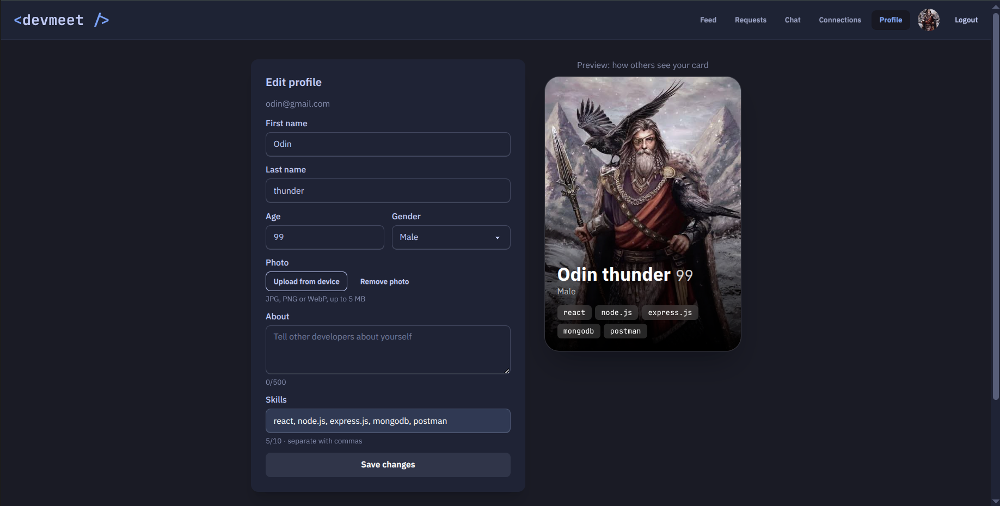
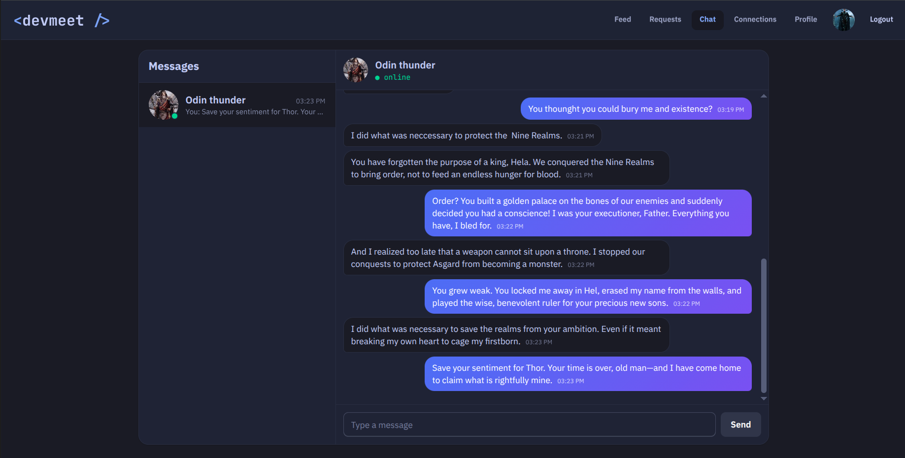
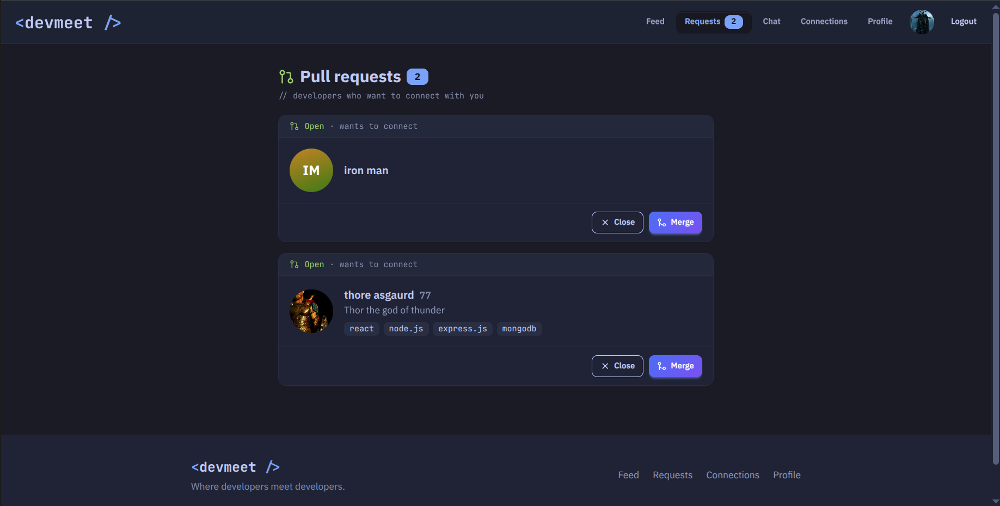

# DevMeet

A matching app for developers. Swipe through profiles, send connection requests, match with developers who share your stack, and chat with them in real time.

**Live demo:** https://devmeet-web-ashy.vercel.app
**API repo:** https://github.com/ashoksohne7/devmeet

> The API runs on a free Render instance, so the first request after a long idle period can take up to a minute.

## Screenshots









## Features

- Sign up and log in with JWT cookie authentication
- Swipe feed with drag, flick and keyboard gestures; tap a card to open the full profile as a `name.json` file
- Stack match bar showing how many skills you share with each developer
- Connection requests presented as pull requests (merge or close)
- Match celebration when a request is accepted
- Real-time chat with typing indicator, online status, latest-first ordering and persistent unread badges (Socket.io)
- Profile editor with live card preview and photo upload to Cloudinary
- Responsive layout with a bottom navigation bar on mobile
- Toasts, a terminal-style 404 page and graceful handling of expired sessions

## Tech stack

React 19, Vite, Redux Toolkit, React Router, Tailwind CSS, daisyUI, Axios, Socket.io client, Lucide icons. Deployed on Vercel.

## Run locally

```bash
npm install
npm run dev
```

The dev server proxies `/api` to the backend at `http://localhost:7777` (see `vite.config.js`), so start the API from the backend repo first.

In production, `vercel.json` rewrites `/api` to the Render backend. The browser therefore talks to a single origin and cookies work without CORS issues. WebSockets cannot pass through that rewrite, so the chat socket connects to the API directly using a short-lived token.

### Optional environment variables

| Name | Default | Purpose |
| --- | --- | --- |
| `VITE_SOCKET_URL` | `http://localhost:7777` in dev, the Render URL in production | Socket.io server |
| `VITE_CLOUDINARY_CLOUD_NAME` | set in `src/utils/cloudinary.js` | Cloudinary account for photo uploads |
| `VITE_CLOUDINARY_PRESET` | set in `src/utils/cloudinary.js` | Unsigned upload preset |

## Project structure
src/
components/ Feed, SwipeCard, ProfileSheet, Requests, Connections, Chat, Profile, ...
utils/ Redux store and slices, axios instance, socket client, helpers
